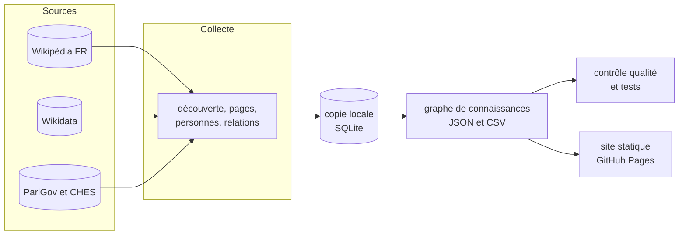

# Généalogie des partis de France

**Graphe de connaissances et frise interactive des partis, mouvements et courants politiques français depuis 1958 : leurs scissions, fusions, changements de nom, et les personnes qui les ont fondés, dirigés ou rejoints.**


Site en ligne : **https://flosa.github.io/Genealogie-Partis-France/**

Tout est construit à partir de Wikipédia en français, de Wikidata, de ParlGov et de la Chapel Hill Expert Survey, **sans
aucune API payante** et **sans lire les pages avec un modèle de langage** : l'extraction est déterministe, donc gratuite,
rejouable et vérifiable.

## Sommaire

- [Architecture](#architecture)
- [Documentation](#documentation)
- [Démarrage](#démarrage)
- [Configuration](#configuration)
- [Tests](#tests)
- [Structure du projet](#structure-du-projet)
- [Licences et composants](#licences--composants)
- [Chiffres](#chiffres-collecte-du-16-octobre-2026)
- [Fonctions du site](#fonctions-du-site)
- [Mettre à jour les données](#mettre-à-jour-les-données)
- [Corriger ou compléter à la main](#corriger-ou-compléter-à-la-main)
- [Limites connues](#limites-connues)

## Architecture

Une chaîne de scripts Python (bibliothèque standard uniquement) découvre les partis, télécharge leurs pages dans une
copie locale SQLite, en extrait dates, relations et personnes, construit le graphe, le contrôle, puis l'exporte vers un
site statique publié sur GitHub Pages.



> Détails : [docs/ARCHITECTURE.md](docs/ARCHITECTURE.md)

## Documentation

| Document | Contenu |
|---|---|
| [CADRAGE.md](docs/CADRAGE.md) | pourquoi : objectifs, périmètre, hypothèses, décisions |
| [ARCHITECTURE.md](docs/ARCHITECTURE.md) | comment : composants, flux, stockage, décisions, sécurité, limites |
| [METHODE.md](docs/METHODE.md) | règles de construction : nationalité, dates, relations, lignées, niveaux de zoom |
| [DEFINITIONS.md](docs/DEFINITIONS.md) | ce qui est de gauche, de droite, d'extrême... : seuils, sources, décisions |
| [SOURCES.md](docs/SOURCES.md) | requêtes exactes, champs lus, citations, vérification d'une donnée |
| [MODELE_DE_DONNEES.md](docs/MODELE_DE_DONNEES.md) | champs des nœuds et des arêtes |
| [JOURNAL.md](docs/JOURNAL.md) | choix, impasses et corrections |

## Démarrage

**Prérequis** : Python 3.12 (testé ; aucune bibliothèque à installer) et un navigateur moderne.

```bash
python -m http.server 8765 --directory site     # ouvrir le site en local
python pipeline/run_all.py 7 8 9 10             # reconstruire graphe, contrôle, site (sans réseau)
python pipeline/run_all.py                      # tout refaire depuis Wikipédia (1 à 2 heures)
```

| Accès | URL | Note |
|---|---|---|
| Site publié | https://flosa.github.io/Genealogie-Partis-France/ | republié à chaque modification de `site/` |
| Site local | http://localhost:8765 | ou double-clic sur `site/index.html` |

## Configuration

| Variable ou fichier | Défaut | Effet |
|---|---|---|
| `PARTIS_FRESH` | non défini | `1` : ne pas relire le cache, les réponses neuves le remplacent (mises à jour) |
| `PYTHONIOENCODING` | selon le système | `utf-8` recommandé sous Windows pour l'affichage des accents |
| argument de `s04b_people.py` | `6` | notoriété minimale (versions linguistiques Wikidata) pour retenir une personne |
| `MIN_DELAY` dans [wikiclient.py](pipeline/wikiclient.py) | `1.1` s | délai minimal entre deux requêtes réseau |
| [data/definitions.json](data/definitions.json) | voir [DEFINITIONS.md](docs/DEFINITIONS.md) | seuils des classes de position, ordre des sources, décisions explicites |
| [data/overrides.json](data/overrides.json) | voir [METHODE.md](docs/METHODE.md) | inclusions, exclusions, dates, niveaux de zoom, rapprochements manuels |

## Tests

```bash
python -m unittest discover -s tests
```

**16 tests**, sans réseau : volumes, identifiants uniques, dates, cycles, couverture des organisations attendues, cas de référence.

## Structure du projet

```text
Genealogie-Partis-France/
├── pipeline/        # scripts Python s00 à s09, run_all.py, run_update.py
├── site/            # site statique : index.html, app.js, style.css, data.js
├── data/
│   ├── graph/       # graphe produit (JSON, CSV)
│   ├── review/      # rapports de contrôle, cas à valider, changements
│   ├── external/    # fichiers ParlGov et CHES
│   ├── raw/         # découverte, données Wikidata ; bases SQLite (non versionnées)
│   ├── definitions.json, overrides.json   # décisions et corrections manuelles
│   └── LICENCE.md   # licences des données
├── docs/            # documentation
├── tests/           # tests de non-régression
├── .github/workflows/pages.yml   # publication du site
├── LICENSE
└── README.md
```

## Licences & composants

| Composant | Rôle | Licence |
|---|---|---|
| Python | chaîne de données (bibliothèque standard uniquement) | PSF-2.0 |
| SQLite | copie locale des pages | domaine public |
| Wikipédia en français | pages de partis et de personnes (résumés, infobox) | CC BY-SA 4.0 |
| Wikidata | identifiants, dates, relations, notoriété | CC0 1.0 |
| ParlGov (Döring et Manow) | résultats électoraux, positions composites | CC0 1.0 (publication 2024, doi:10.7910/DVN/2VZ5ZC) |
| Chapel Hill Expert Survey | positions d'experts 1999-2024 | citation demandée (Rovny et al., 2025, *Electoral Studies* 97) |
| GitHub Pages et Actions | publication du site | service GitHub |
| **Ce projet** | code applicatif | MIT — Copyright (c) 2026 floSa |

Les données dérivées de Wikipédia restent sous CC BY-SA 4.0 : voir [data/LICENCE.md](data/LICENCE.md) et [docs/SOURCES.md](docs/SOURCES.md).

## Chiffres (collecte du 16 octobre 2026)

- **646 organisations** (603 depuis 1958, 43 ancêtres antérieurs reliés) : 372 partis, 147 mouvements et organisations,
  44 coalitions, 14 courants internes, 18 mouvements de jeunesse, 19 associations, 4 think tanks, 5 micro-partis et
  23 groupes parlementaires (masqués par défaut sur le site).
- **590 relations** entre organisations : 168 scissions, 137 fusions, 45 successions, 224 affiliations et 16 rattachements
  de courants internes. 180 sont confirmées par les deux pages concernées, 3 par une page et Wikidata, 13 ne reposent que sur Wikidata.
- **2 364 personnes** et **5 568 liens** (4 741 adhésions, 630 mandats de dirigeants, 197 fondations).
- **97 %** des organisations ont une date de fondation (17 n'en ont aucune et ne sont pas dessinées).
- **62 %** ont une position gauche-droite lue ou déduite ; 185 sont placées d'après leur famille (contour en pointillés), 56 sont « non positionnées ».
- **91 %** ont au moins une famille politique ; 22 organisations « périphériques » (basques espagnols, Afrique coloniale...) sont conservées mais masquées.

## Fonctions du site

- une frise verticale du temps (1958 en haut) sur un axe gauche-droite ;
- un zoom par zone du spectre et un curseur de niveau de détail (grands partis, principaux, tous) ;
- les scissions, fusions et successions tracées entre les barres, les coalitions en option ; les changements de nom
  sur une même ligne (RPR, UMP, Les Républicains) ;
- un clic sur un parti : résumé, origine, scissions, courants, fondateurs, dirigeants, résultats électoraux, positions d'experts,
  et la raison de sa position (« Pourquoi cette position ? ») ;
- un clic sur une personne (ou la recherche) : son parcours tracé à travers les partis ;
- une photographie à une date donnée, des liens permanents, un export CSV et un formulaire « Corriger cette fiche » ;
- des filtres par famille politique et par nature.

## Mettre à jour les données

```bash
python pipeline/run_update.py            # vérifie les pages, découvre les nouveaux partis, reconstruit
python pipeline/run_update.py --offline  # reconstruction et rapport seulement (sans réseau)
```

La mise à jour compare la révision de chaque page stockée avec celle de Wikipédia (une requête par lot de 50 pages), ne
retélécharge que les pages modifiées, puis écrit `data/review/CHANGEMENTS.md` : organisations nouvelles ou disparues, dates
et relations modifiées, nouveaux candidats. Compter 15 à 30 minutes, **aucun jeton consommé**.

## Corriger ou compléter à la main

Ne jamais modifier `data/graph/` ou `data/raw/` à la main : ils sont régénérés. Les corrections vont dans
[data/overrides.json](data/overrides.json) et [data/definitions.json](data/definitions.json), puis
`python pipeline/run_all.py 7 8 9 10`. [data/review/A_VALIDER.md](data/review/A_VALIDER.md) regroupe les cas que les règles
automatiques ne tranchent pas ; `excluded.csv` et `unresolved_edges.csv` (même dossier) indiquent ce qui a été écarté.

## Limites connues

- Wikipédia ne donne souvent que l'année ; les positions gauche-droite viennent d'abord des experts, puis de ParlGov et de
  Wikipédia, et 185 organisations n'ont qu'une position estimée.
- Les très petits partis sans page Wikipédia n'existent pas ici ; les courants internes sont ceux que Wikipédia classe comme tels.
- Ni présidentielles, ni élus locaux, ni programmes détaillés ; le site n'a pas de test automatique.
- Détail et pistes : [docs/ARCHITECTURE.md](docs/ARCHITECTURE.md) (section 8) et [docs/METHODE.md](docs/METHODE.md).
