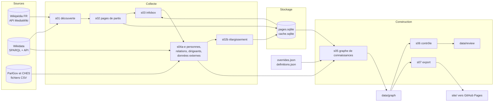

# Architecture — Généalogie des partis de France

Le **pourquoi** du projet est dans [CADRAGE.md](CADRAGE.md) ; les règles de construction (dates, nationalité,
position, familles) dans [METHODE.md](METHODE.md) et [DEFINITIONS.md](DEFINITIONS.md).

## 1. Vue d'ensemble

Une chaîne de scripts Python **sans dépendance externe** lit Wikipédia en français, Wikidata, ParlGov et CHES,
garde une copie locale dans deux bases SQLite, construit un graphe de connaissances (JSON et CSV) puis l'exporte
vers un site statique. Chaque étape lit les fichiers produits par la précédente et peut être relancée seule.
Aucun modèle de langage n'intervient : la chaîne est gratuite, rejouable et vérifiable.

---

## 2. Composants

| Étape | Script | Lit | Écrit |
|---|---|---|---|
| 0 | `s00_refresh.py` | révisions des pages stockées (`prop=info`) | pages modifiées dans `pages.sqlite`, `data/raw/refresh_report.json` |
| 1 | `s01_discover.py` | Wikidata, API Wikipédia | `data/raw/discovery.json` |
| 2 | `s02_fetch_parties.py` | `discovery.json` | `pages.sqlite`, `promoted.json` |
| 3 | `s03_parse_parties.py` | `pages.sqlite` | `data/graph/parties_raw.json` |
| 4a | `s04a_wikidata_people.py` | Wikidata | `data/raw/wd_people.json` |
| 4c | `s04c_wikidata_relations.py` | Wikidata | `data/raw/wd_relations.json` |
| 4d | `s04d_leaders.py` | `parties_raw.json`, `pages.sqlite` | `data/graph/leaders_raw.json` |
| 4b | `s04b_people.py` | `parties_raw.json`, `wd_people.json`, `leaders_raw.json` | `pages.sqlite`, `data/graph/people_raw.json` |
| 5 | `s02b_snowball.py` | `parties_raw.json`, `people_raw.json` | pages nouvelles dans `pages.sqlite` |
| 6 | `s02c_wikidata_entities.py` | `pages.sqlite` | `data/raw/wd_entities.json` |
| 6 | `s04e_external_data.py` | ParlGov, CHES, `parties_raw.json` | `data/external/*.csv`, `data/graph/external_raw.json` |
| 7 | `s05_build_graph.py` | tout ce qui précède, `overrides.json`, `definitions.json` | `nodes.json`, `edges.json`, `graph.json`, CSV |
| 8 | `s06_validate.py` | le graphe | `data/review/*` |
| 9 | `s07_export_site.py` | le graphe, `definitions.json` | `site/data.js` |
| 10 | `s08_review_list.py` | le graphe | `data/review/A_VALIDER.md` |
| — | `s09_diff_builds.py` | graphe courant et précédent | `data/review/CHANGEMENTS.md` |

Les numéros d'étape de [run_all.py](../pipeline/run_all.py) suivent ce tableau ; [run_update.py](../pipeline/run_update.py)
enchaîne la mise à jour réseau, la reconstruction et le rapport de changements.

**Modules partagés**

| Module | Rôle |
|---|---|
| [wikiclient.py](../pipeline/wikiclient.py) | client HTTP poli : une requête à la fois, 1,1 s d'écart, nouvelles tentatives, cache SQLite (table `cache`), requêtes SPARQL, mode `PARTIS_FRESH=1` |
| [pagestore.py](../pipeline/pagestore.py) | copie locale des pages : tables `pages` (titre, révision, identifiant Wikidata, portée `full` ou `lead`, wikitexte et résumé compressés), `redirects`, `missing`, `cats`, `cats_done` ; ne remplace jamais une page complète par une introduction |
| [wikiparse.py](../pipeline/wikiparse.py) | lecture du wikitexte : modèles `{{ }}` imbriqués, liens `[[ ]]`, dates françaises (« 5 février 2009 », « (2011-2017) », « depuis 2017 »), position gauche-droite |
| [client_shortcuts.py](../pipeline/client_shortcuts.py) | ouvre le client et la copie locale en une ligne |

---

## 3. Stack technologique

| Couche | Technologie | Version |
|---|---|---|
| Chaîne de données | Python, bibliothèque standard | 3.12.10 |
| Copie locale | SQLite (module `sqlite3`) | 3.49.1 |
| Interface | HTML, CSS, JavaScript natifs, SVG | navigateur moderne |
| Tests | `unittest` | bibliothèque standard |
| Publication | GitHub Pages par GitHub Actions (`actions/deploy-pages`) | v4 |

---

## 4. Flux de bout en bout

1. **Découverte** : les partis français sont listés par trois sources croisées (Wikidata, pages avec l'infobox de parti, catégories).
2. **Copie locale** : les pages sont téléchargées par lots de 20 dans `pages.sqlite` (wikitexte complet ou introduction seule).
3. **Analyse** : les infobox donnent dates, relations (scission, fusion, succession, coalition) et positionnement ; les pages de personnes donnent partis et fonctions avec dates.
4. **Compléments** : relations Wikidata, dirigeants lus dans les tableaux, résultats électoraux et positions d'experts (ParlGov, CHES).
5. **Élargissement** : tout parti cité mais absent de la base est téléchargé, jusqu'à ce que plus rien de nouveau n'apparaisse.
6. **Construction** : sélection des organisations françaises, dates, arêtes avec preuves, lignées, arbitrage des positions, niveaux de zoom.
7. **Contrôle et export** : anomalies, couverture, tests ; écriture de `site/data.js` ; publication.

---

## 5. Stockage

| Fichier | Contenu | Versionné |
|---|---|---|
| `data/raw/cache.sqlite` | `cache(k, v, ts)` : réponses JSON brutes compressées | non (environ 50 Mo) |
| `data/raw/pages.sqlite` | `pages`, `redirects(src, dst)`, `missing(title)`, `cats(title, cat)`, `cats_done(title)` | non (environ 30 Mo) |
| `data/raw/*.json` | découverte, personnes et relations Wikidata, entités | oui |
| `data/external/*.csv` | fichiers ParlGov et CHES | oui |
| `data/graph/` | graphe (`graph.json`, `nodes.json`, `edges.json`), CSV, fichiers intermédiaires `*_raw.json` | oui |
| `data/review/` | rapports de contrôle, anomalies, cas à valider, changements | oui |
| `data/snapshots/` | copie de la construction précédente pour le rapport de changements | non |

Les deux bases SQLite se reconstruisent : `python pipeline/run_all.py 1 2 3 4 5 6` (une à deux heures, une requête par seconde).

**Du graphe au site.** [s07_export_site.py](../pipeline/s07_export_site.py) écrit `site/data.js`
(`window.GRAPH = {...}`, champs raccourcis, environ 2,2 Mo). [site/app.js](../site/app.js) ne dépend d'aucune bibliothèque :
il construit le SVG à la main (barres, liens, étiquettes, axe), place les organisations en couloirs
(une lignée de changements de nom partage un couloir) et applique le zoom par niveau de détail et par zone du spectre.

---

## 6. Décisions d'architecture

- **Extraction déterministe** **plutôt que** lecture des pages par un modèle de langage, **parce que** la chaîne doit
  être gratuite, rejouable et vérifiable ligne par ligne ; chaque relation garde sa preuve (page, champ, texte).
  *Limite* : les sections en prose ne sont pas exploitées.
- **Copie locale SQLite d'abord** **plutôt que** requêtes à la demande, **parce que** Wikimédia limite le débit et
  que toute analyse doit se rejouer hors ligne. *Limite* : environ 80 Mo de bases à reconstruire à la main si on les perd.
- **Wikipédia pour les relations, Wikidata pour les identifiants et la notoriété**, **parce que** Wikidata ne contient
  que 126 relations de filiation entre partis français alors que les infobox donnent scissions, fusions et successions
  avec années. Wikidata sert de seconde source pour confirmer.
- **Graphe multi-relationnel (multigraphe)** **plutôt qu'arbre**, **parce que** deux organisations peuvent être liées
  par plusieurs types de relations (scission puis fusion de retour). *Limite* : les cycles entre types différents
  sont normaux, seuls ceux d'un même type sont signalés.
- **Heuristiques signalées** : tout ce qui est déduit (date tirée d'un résumé, position estimée, inclusion par règle souple)
  porte un drapeau (`flags`) et s'affiche différemment sur le site.
- **Décisions hors du code** : [overrides.json](../data/overrides.json) et [definitions.json](../data/definitions.json),
  lisibles et versionnés, pour trancher à la main sans modifier les scripts.
- **Site statique sans bibliothèque** **plutôt que** framework, **parce qu'il s'ouvre par double-clic et se publie tel quel**.
  *Limite* : tout le rendu est écrit à la main.

---

## 7. Sécurité (récapitulatif)

Le projet n'a **ni secret, ni identifiant, ni service exposé** : il lit des données publiques et publie des fichiers statiques.

| Durcissement | Effet |
|---|---|
| Requêtes séquentielles, `User-Agent` descriptif, `maxlag=5`, respect de `Retry-After` | ne surcharge pas les serveurs Wikimédia |
| Toutes les chaînes affichées par le site passent par `esc()` (échappement HTML) | pas d'injection de contenu venant de Wikipédia dans la page |
| Aucun script externe, aucune police ni image distante dans le site | pas de suivi, pas de dépendance à un tiers |
| Aucune clé ni jeton dans le dépôt ; recherche de motifs (`api_key`, `password`, `ghp_...`) faite avant la publication | pas de fuite d'identifiants |
| Corrections manuelles lisibles et versionnées | toute décision est traçable dans git |

---

## 8. Limites connues & pistes

| Aspect | Limitation / État | Recommandation |
|---|---|---|
| Pages sans infobox | classées par la première phrase et les catégories : quelques organisations manquent ou sont en trop | relire `data/review/A_VALIDER.md` |
| Relations | 378 sur 590 ne reposent que sur une page | croiser avec d'autres sources |
| Positions | 62 % lues sur Wikipédia ou déduites des relations, 185 estimées par famille, 56 non positionnées | étendre CHES et ParlGov |
| Tests du site | aucun test automatique ; vérification manuelle dans un navigateur | ajouter des tests de bout en bout |
| Présidentielles, élus locaux | absents | lire les tableaux des pages d'élection de Wikipédia |
| Mises à jour | 15 à 30 minutes de réseau, sans planification automatique | planifier `run_update.py` chaque mois |
