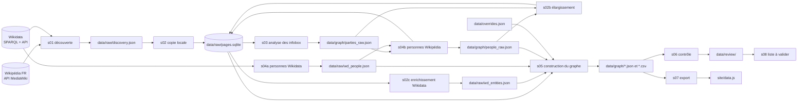

# Architecture de la chaîne

La chaîne se lit de gauche à droite : on découvre, on télécharge, on analyse, on construit, on
contrôle, on exporte. Chaque étape lit des fichiers ou des tables produits par la précédente et
peut être relancée seule.

## Étapes, entrées, sorties

| Étape | Script | Lit | Écrit |
|---|---|---|---|
| 1 | `s01_discover.py` | Wikidata, API Wikipédia | `data/raw/discovery.json` |
| 2 | `s02_fetch_parties.py` | `discovery.json` | `pages.sqlite`, `promoted.json` |
| 3 | `s03_parse_parties.py` | `pages.sqlite` | `data/graph/parties_raw.json` |
| 4a | `s04a_wikidata_people.py` | Wikidata | `data/raw/wd_people.json` |
| 4c | `s04c_wikidata_relations.py` | Wikidata | `data/raw/wd_relations.json` |
| 4d | `s04d_leaders.py` | `parties_raw.json`, `pages.sqlite` | `data/graph/leaders_raw.json`, `pages.sqlite` |
| 4b | `s04b_people.py` | `parties_raw.json`, `wd_people.json` | `pages.sqlite`, `data/graph/people_raw.json` |
| 5 | `s02b_snowball.py` | `parties_raw.json`, `people_raw.json` | `pages.sqlite` (pages nouvelles) |
| 6 | `s02c_wikidata_entities.py` | `pages.sqlite` | `data/raw/wd_entities.json` |
| 7 | `s05_build_graph.py` | tout ce qui précède, `overrides.json` | `nodes.json`, `edges.json`, `graph.json`, CSV |
| 8 | `s06_validate.py` | le graphe | `data/review/*` |
| 9 | `s07_export_site.py` | le graphe | `site/data.js` |
| 10 | `s08_review_list.py` | le graphe, `_build_side.json` | `data/review/A_VALIDER.md` |

`s00_refresh.py` (mise à jour incrémentale) et `s09_diff_builds.py` (rapport de changements) complètent la chaîne ; `run_update.py` les enchaîne avec les autres. `run_all.py` enchaîne les étapes du tableau (`python pipeline/run_all.py` pour tout, ou une liste de numéros).
Les numéros d'étape de `run_all.py` suivent le tableau ci-dessus ; les noms de fichiers conservent
l'ordre historique de création.

## Modules partagés

| Module | Rôle |
|---|---|
| `wikiclient.py` | client HTTP poli : une requête à la fois, délai, nouvelles tentatives, cache SQLite (table `cache`), requêtes SPARQL |
| `pagestore.py` | copie locale des pages : table `pages` (titre, révision, identifiant Wikidata, portée `full` ou `lead`, wikitexte et résumé compressés), `redirects`, `missing`, `cats` ; ne remplace jamais une page complète par une introduction |
| `wikiparse.py` | lecture du wikitexte sans dépendance : modèles `{{ }}` imbriqués, liens `[[ ]]`, dates françaises (« 5 février 2009 », « (2011-2017) », « depuis 2017 »), position gauche-droite |
| `client_shortcuts.py` | ouvre le client et la copie locale en une ligne |

## Bases SQLite (`data/raw/`)

`cache.sqlite` : `cache(k, v, ts)`, réponses JSON brutes compressées. `pages.sqlite` : `pages`,
`redirects(src, dst)`, `missing(title)`, `cats(title, cat)`, `cats_done(title)`. Ces deux fichiers
(environ 85 Mo) ne sont pas versionnés avec le code : ils se reconstruisent (voir `docs/METHODE.md`).

## Du graphe au site

`s07_export_site.py` écrit `site/data.js` (`window.GRAPH = {...}`) avec des noms de champs courts ;
`site/app.js` ne dépend d'aucune bibliothèque : il construit le SVG à la main (barres, liens,
étiquettes, axe), place les organisations en couloirs (une lignée de changements de nom partage un
couloir), et applique le zoom sémantique par niveau de détail et par zone du spectre.

## Décisions de conception

- **Déterminisme** : pas de modèle de langage dans la chaîne, donc pas de coût et pas d'hallucination ;
  les règles sont dans le code et les décisions de classement sont journalisées (`excluded.csv`).
- **Copie locale d'abord** : les pages sont téléchargées une fois ; toute analyse se rejoue sans réseau.
- **Preuve attachée à chaque relation** : champ, page et texte d'origine.
- **Heuristiques signalées** : tout ce qui est déduit (date de résumé, position estimée, inclusion
  par règle souple) porte un drapeau et s'affiche différemment sur le site.
- **Corrections hors du code** : `data/overrides.json`, lisible et versionné, pour trancher à la main
  sans toucher aux scripts.
